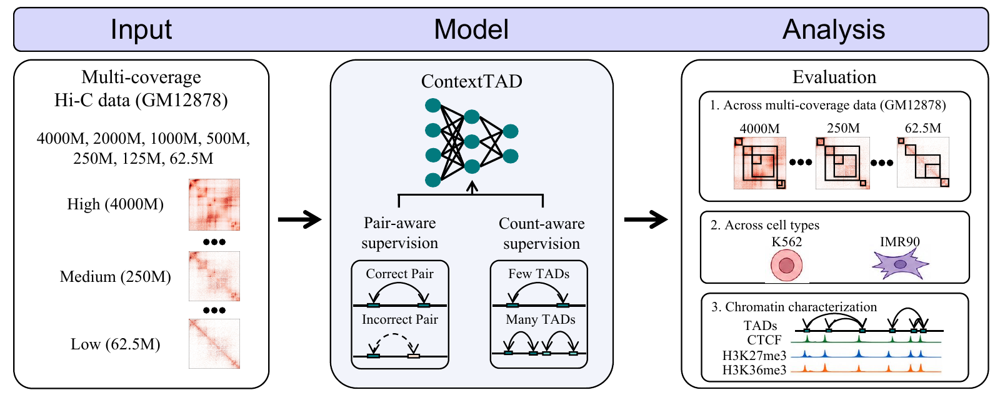
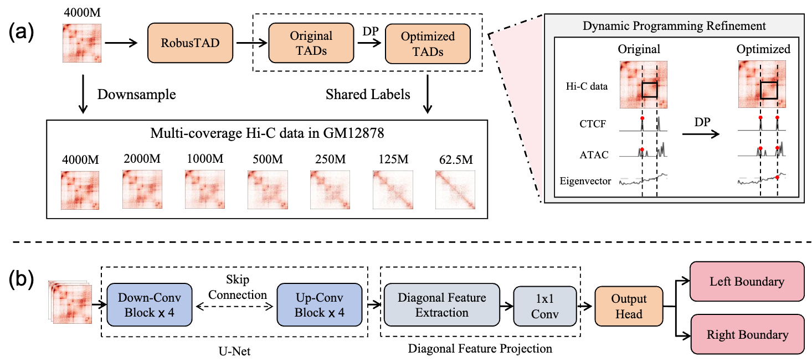
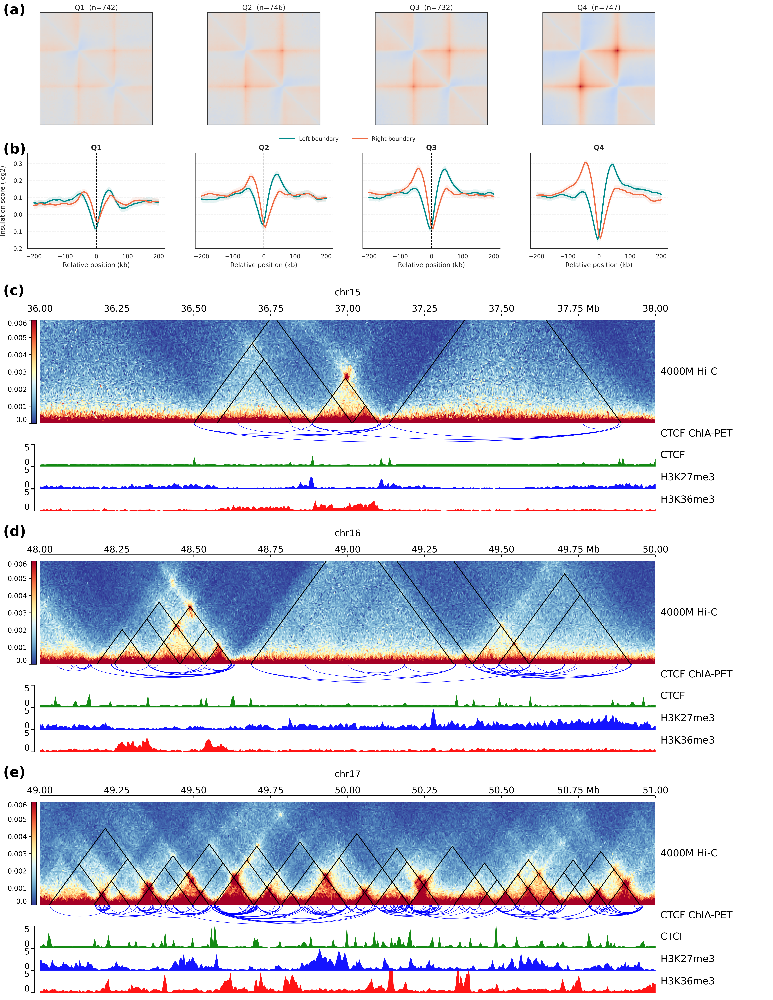

# ContextTAD

ContextTAD is a deep-learning TAD caller that learns boundary evidence from broader local Hi-C windows that capture TAD-scale structural context. Instead of treating boundary prediction as an isolated per-bin classification problem, ContextTAD uses a context-aware representation to produce left- and right-boundary tracks that are explicitly optimized to support downstream TAD construction.



## Overview

ContextTAD operates on single-channel observed-over-expected (O/E) Hi-C maps. Each input is a `400 x 400` matrix at 5-kb resolution and therefore covers a 2-Mb genomic window.

The current model contains three components:

1. A residual U-Net trained from scratch extracts multiscale two-dimensional contact-map features and restores them to the original spatial resolution.
2. A diagonal feature projection module extracts a 101-bin band around the main diagonal and maps the two-dimensional features to a genomic-bin-aligned sequence.
3. Shared one-dimensional convolutional layers and two directional heads predict left- and right-boundary probability tracks of length 400.

The model is trained with a pair objective and a count objective normalized by the number of bins per window, with count-loss weight 32 and gradient clipping at 1. At inference time, overlapping-window predictions are averaged into chromosome-level tracks. A single distance-band-shifted decoy map is inferred per window; target and decoy boundary peaks are paired by endpoint probability product, then final TADs are selected at FDR 0.05 after deduplication and nesting-aware pruning.



## Example structural characterization

The following analyses stratify predicted TADs by ContextTAD pair confidence and show aggregate contact structure, boundary-centered insulation profiles, and representative genomic regions.



## Model checkpoint

The trained ContextTAD checkpoint is distributed through Hugging Face:

[Link to HuggingFace ModelHub](https://huggingface.co/CompBioDSA/ContextTAD)

## Repository layout

```text
ContextTAD/
├── 0-data/                         # Expected data layout and bundled benchmark summaries
├── 1-prepare_data/
│   ├── step1_process_data/         # Hi-C and genomic-track preprocessing
│   ├── step2_prepare_labels/       # Window arrays and refined labels
│   └── step3_build_gt/             # Ground-truth BED utilities
├── 2-training/
│   ├── core/                       # Model, loss, training, decoding, and postprocessing
│   ├── step1_train/                # Training entry points and outputs
│   └── step2_infer_decode/         # GM12878 and cross-cell inference
├── 3-evaluation/
│   ├── common/                     # Shared evaluation implementations
│   ├── step1_main_results_vs_tools/
│   └── step2_model_ablation_ours_only/
├── 4-fullpipeline/                 # One-command train/infer/evaluate workflow
└── figs/
```

## Environment setup

Create one environment for model training, inference, and the Python evaluation scripts:

```bash
conda create -n contexttad python=3.12 -y
conda activate contexttad
pip install -r requirements.txt
```

The released experiments used PyTorch 2.6, CUDA 12.4, and Hugging Face Accelerate. Install the PyTorch build appropriate for the CUDA driver on your system if the default wheel is unsuitable.

Some optional evaluation or visualization workflows additionally require:

- `Rscript` for structural-protein enrichment.
- `bedtools` and `Rscript` for the histone-modification permutation test.
- `coolpup.py` for aggregate TAD pileups.
- `pyGenomeTracks` for locus-level genome-track visualization.

## Data preparation

The full processed dataset is too large to keep in the Git repository. The expected layout, array format, and preprocessing inputs are documented in [`0-data/README.md`](0-data/README.md).

Most processed resources are available from [Zenodo](https://doi.org/10.5281/zenodo.21859307). Raw `.mcool` files should be downloaded from the 4DN Data Portal.

The two required data roots are:

```text
0-data/1_dp_train_infer_data/
0-data/2_eval_tads_data/
```

You may place them elsewhere and set:

```bash
export TAD_DATA_DIR=/path/to/1_dp_train_infer_data
export EVAL_DATA_ROOT=/path/to/2_eval_tads_data
```

### Main data sources

| Category | Cell line | Identifier or file | Source |
|---|---|---|---|
| Hi-C | GM12878 | `4DNFIXP4QG5B` and downsampled fractions | 4DN Data Portal |
| Hi-C | K562 | `4DNFI4DGNY7J` | 4DN Data Portal |
| Hi-C | IMR90 | `4DNFIJTOIGOI` | 4DN Data Portal |
| CTCF ChIP-seq | GM12878 | `ENCFF796WRU` | ENCODE |
| CTCF signal bigWig | GM12878 | `ENCFF232FCT` | ENCODE |
| CTCF ChIP-seq | K562 | `ENCFF901CBP` | ENCODE |
| CTCF ChIP-seq | IMR90 | `ENCFF203SRF` | ENCODE |
| CTCF ChIA-PET | GM12878 | `GSE72816` | GEO |
| CTCF ChIA-PET | K562 | `ENCFF001THV` | ENCODE |
| CTCF ChIA-PET | IMR90 | `ENCFF682YFU` | ENCODE |
| H3K27me3 ChIP-seq | GM12878 | `ENCFF039JOT` | ENCODE |
| H3K36me3 ChIP-seq | GM12878 | `ENCFF171MDW` | ENCODE |

The data sourcing follows the resources described by [RefHiC](https://www.nature.com/articles/s41467-022-35231-3).

## How to run (step by step)

The workflow is deliberately separated into data preparation, training,
inference/TAD construction, and evaluation. Run commands from the repository
root unless stated otherwise.

### Step 1: prepare training and inference arrays

Build the GM12878 windows after configuring the raw Hi-C and genomic-track
paths required by the preprocessing scripts:

```bash
python 1-prepare_data/step2_prepare_labels/scripts/prepare_data.py
```

The command will create the seven coverage directories, shared DP-refined labels,
and `window_list.json` under `TAD_DATA_DIR`. To process only a subset of the
coverage levels, use one of the following mutually exclusive options:

```bash
# Build only the 4000M arrays.
python 1-prepare_data/step2_prepare_labels/scripts/prepare_data.py --only-4000M

# Build all downsampled arrays while reusing an existing 4000M directory.
python 1-prepare_data/step2_prepare_labels/scripts/prepare_data.py --skip-4000M
```

Build K562 or IMR90 arrays for cross-cell inference with:

```bash
python 1-prepare_data/step1_process_data/scripts/prepare_othercell_inference_data.py \
  --mcool /path/to/cell_line.mcool::/resolutions/5000 \
  --out_data_dir "$TAD_DATA_DIR/other_celltypes/K562" \
  --coverage_tag K562
```

Here, `--mcool` selects the 5-kb matrix, `--out_data_dir` is the destination
for the processed windows, and `--coverage_tag` is the identifier written into
the generated metadata. Replace `K562` with `IMR90` for the second cell line.

### Step 2: train the base model

The base experiment uses O/E inputs, a diagonal radius of 50 bins, and random
coverage sampling for both training and validation.

```bash
bash 2-training/step1_train/scripts/run_train_base.sh \
  --gpu-ids 0 \
  --run-id train_base_$(date +%Y%m%d_%H%M%S) \
  --epochs 50 \
  --batch-size 16 \
  --count-lambda 32
```

`--gpu-ids` selects the devices exposed to Accelerate; use `--gpu-ids 0,1, ...` for
multi-GPU distributed training.

Outputs are written under:

```text
2-training/step1_train/outputs/<run_id>/
├── logs/
├── run_command.sh
└── train_outputs/
    ├── args.json
    ├── best_model.pt
    ├── final_model.pt
    ├── history.json
    └── checkpoints/
```

Inspect the training curves with:

```bash
tensorboard --logdir 2-training/step1_train/outputs
```

### Step 3: infer GM12878 TADs

Run the best checkpoint on all seven GM12878 coverage levels for held-out
chromosomes 15, 16, and 17:

```bash
bash 2-training/step2_infer_decode/scripts/run_infer_decode_gm12878.sh \
  --checkpoint /path/to/best_model.pt \
  --gpu-id 0 \
  --run-id infer_gm12878_$(date +%Y%m%d_%H%M%S)
```

`--checkpoint` accepts a checkpoint produced in Step 2 or downloaded from
Hugging Face. `--gpu-id` selects the inference device, and `--run-id` names the
output directory.

This stage writes cached chromosome-level target/decoy boundary tracks,
postprocessing statistics, and final BED files under
`2-training/step2_infer_decode/outputs/<run_id>/`.

### Step 4: infer K562 and IMR90 TADs (optional)

Cross-cell inference uses the same checkpoint and decoder:

```bash
bash 2-training/step2_infer_decode/scripts/run_infer_decode_othercell.sh \
  --checkpoint /path/to/best_model.pt \
  --gpu-id 0 \
  --run-id infer_othercell_$(date +%Y%m%d_%H%M%S) \
  --data-root "$OTHERCELL_DATA_ROOT"
```

`--data-root` must contain the processed `K562/` and `IMR90/` array
directories. If omitted, the script uses the default location documented in
`0-data/README.md`.

### Step 5: evaluate the predictions

Evaluate the main GM12878 and cross-cell results against the reference callers:

```bash
bash 3-evaluation/step1_main_results_vs_tools/scripts/run_main_results.sh \
  --gm12878-beds /path/to/gm12878_beds \
  --othercell-beds /path/to/othercell_beds \
  --run-id main_results_$(date +%Y%m%d_%H%M%S) \
  --run-coolpup \
  --run-histone
```

`--gm12878-beds` refers to the seven-coverage output from Step 3, while
`--othercell-beds` refers to the K562/IMR90 output from Step 4.
`--run-histone` enables the histone permutation test, and
`--run-coolpup` enables aggregate pileup analysis. Omit either flag to skip that
optional experiment. TAD-size statistics are always computed because they only
require the 250M BED files.

Evaluate one ContextTAD variant on the core GM12878 experiments with:

```bash
bash 3-evaluation/step2_model_ablation_ours_only/scripts/run_model_ablation_eval.sh \
  --gm12878-beds /path/to/gm12878_beds \
  --run-id ablation_eval_$(date +%Y%m%d_%H%M%S)
```

This lightweight route runs exp1, exp3, exp4, and exp6 without requiring
other-cell data, histone tracks, or `.mcool` files.

### Evaluation experiment catalog

| Experiment | Analysis | Main manuscript use |
|---|---|---|
| `exp1_tadnum_ctcf_chiapet` | 250M CTCF ChIA-PET-supported L0/L1+ TAD counts | Figure 2b |
| `exp2_struct_protein` | CTCF, RAD21, and SMC3 boundary enrichment | Figure 2c |
| `exp3_tadb_left_ctcf_chipseq` | Left-boundary CTCF ChIP-seq support | Figure 2d |
| `exp4_tadb_right_ctcf_chipseq` | Right-boundary CTCF ChIP-seq support | Figure 2e |
| `exp5_coolpup` | Aggregate TAD pileups | Figure 5 |
| `exp6_tadnum_ctcf_chiapet_downsample` | Seven-coverage TAD counts and CTCF support | Figure 3 |
| `exp7_othercell_tadnum_ctcf_chiapet` | K562/IMR90 CTCF ChIA-PET support | Figure 4 |
| `exp8_othercell_both_ctcf_chipseq` | K562/IMR90 directional boundary support | Figure 4 |
| `exp9_tad_size` | 250M TAD-size distribution and median ranking | Figure 2a |
| `exp10_histone_modification` | H3K27me3/H3K36me3 contrast permutation test | Figure 2f |
| `exp11_pairscore_structure` | Pair-score quartile pileups, boundary insulation, and representative regions | Figure 6 |

Each directory under `3-evaluation/common/` contains its executable entry point
and a `DATA_REQUIREMENTS.md` file describing the required inputs and metric.

Run the two additional Figure 2 analyses independently with:

```bash
# TAD-size statistics (Figure 2a).
EVAL_DATA_ROOT=/path/to/2_eval_tads_data \
bash 3-evaluation/common/exp9_tad_size/run_exp9.sh

# Histone-modification contrast (Figure 2f).
EVAL_DATA_ROOT=/path/to/2_eval_tads_data \
RSCRIPT_BIN=/path/to/Rscript \
BEDTOOLS_BIN=/path/to/bedtools \
bash 3-evaluation/common/exp10_histone_modification/run_exp10.sh
```

`EVAL_DATA_ROOT` supplies the reference callers and benchmark tracks.
`RSCRIPT_BIN` and `BEDTOOLS_BIN` may be omitted when both commands are already
available on `PATH`.

Run the Figure 6 structural characterization independently because it requires
both final calls and the scored raw candidates from the same 4000M inference
run:

```bash
bash 3-evaluation/common/exp11_pairscore_structure/run_exp11.sh \
  --final-bed /path/to/GM12878_4000M_contexttad.bed \
  --raw-bed /path/to/ContextTAD_structure_4000M.bed \
  --mcool /path/to/GM12878_4000M.mcool \
  --chiapet /path/to/gm12878_ctcf_chiapet.bedpe \
  --ctcf /path/to/ENCFF232FCT_CTCF.bigWig \
  --h3k27 /path/to/ENCFF039JOT_H3K27me3.bigWig \
  --h3k36 /path/to/ENCFF171MDW_H3K36me3.bigWig \
  --output-dir /path/to/figure6_results \
  --cache-dir /path/to/figure6_cache
```

This produces the pair-score quartile pileups, left/right insulation profiles,
three representative genomic regions, and `fig6_final.{png,pdf}`. See
[`exp11_pairscore_structure/DATA_REQUIREMENTS.md`](3-evaluation/common/exp11_pairscore_structure/DATA_REQUIREMENTS.md)
for exact formats.

### Step 6: run the complete pipeline with one command

The shortest command trains on GPU 0, infers on GPU 0, and runs the core
GM12878 evaluation suite:

```bash
bash 4-fullpipeline/run_full_pipeline.sh \
  --train-gpus 0 \
  --infer-gpu 0
```

The omitted options use an automatically generated run ID, batch size 16, the
default Accelerate port, and the default 50-epoch schedule.

Run the complete suite, including K562/IMR90 inference, coolpup, TAD-size, and
histone-modification analyses, with:

```bash
bash 4-fullpipeline/run_full_pipeline.sh \
  --train-gpus 0 \
  --infer-gpu 0 \
  --run-id full_$(date +%Y%m%d_%H%M%S) \
  --train-epochs 50 \
  --batch-size 16 \
  --master-port 29600 \
  --all-exps
```

`--train-gpus` accepts one or more comma-separated devices, whereas
`--infer-gpu` selects one inference device. `--all-exps` enables other-cell
inference and the ten standard benchmark workflows. Figure 6 remains a
standalone analysis because it additionally consumes scored raw candidates and
genome-track files. The full-pipeline output contains symlinks to stage-specific
products; model weights remain only under `2-training/step1_train/outputs/`.

### Step 7: run ablation experiments

All ablations retain the base architecture and optimization settings unless
explicitly changed. Each wrapper accepts the same arguments as
`run_train_base.sh`:

```bash
# Observed contact matrix instead of O/E.
bash 2-training/step1_train/scripts/run_train_obs_input.sh \
  --gpu-ids 0 --run-id obs_input_run --epochs 50 --batch-size 16

# Pair objective removed.
bash 2-training/step1_train/scripts/run_train_no_pairloss.sh \
  --gpu-ids 0 --run-id no_pair_run --epochs 50 --batch-size 16

# Count objective removed.
bash 2-training/step1_train/scripts/run_train_no_count.sh \
  --gpu-ids 0 --run-id no_count_run --epochs 50 --batch-size 16

# Boundary BCE plus count objective, without pair loss.
bash 2-training/step1_train/scripts/run_train_boundary_count.sh \
  --gpu-ids 0 --run-id boundary_count_run --epochs 50 --batch-size 16
```
